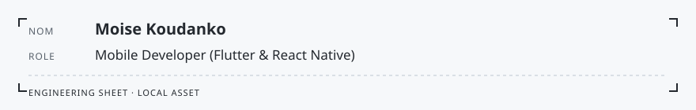

<!-- readmy:template=engineer;version=2.0.0;composants=banner@2.0.0,identity@2.0.0,prose@2.0.0,principles@2.0.0,stack@2.0.0,projects@2.0.0,links@2.0.0,colophon@2.0.0 -->

<picture>
  <source media="(prefers-color-scheme: dark)" srcset="./assets/banner-dark.svg" />
  <source media="(prefers-color-scheme: light)" srcset="./assets/banner-light.svg" />
  
</picture>

<h1>Moise Koudanko</h1>

Mobile Developer (Flutter &amp; React Native)

<!-- section:organisation omise : champ absent -->
<!-- section:lieu omise : champ absent -->

<h2>En bref</h2>

Mobile Developer specializing in Flutter and React Native, design enthusiast, and student in Computer Science &amp; Applied Mathematics. Focused on crafting responsive, aesthetic, and scalable digital experiences.

<!-- section:principes omise : liste vide ou absente -->

<h2>Stack</h2>
<ul>
<li><strong>Langages</strong> — TypeScript, TeX, Dart</li>
</ul>

<h2>Projets</h2>
<table width="100%">
<tbody>
  <tr>
    <td width="50%" valign="top">
      <h3><a href="https://github.com/Monde123/freeTV">freeTV</a></h3>
      
Cross-platform TV streaming application built with TypeScript architecture.

      
 · <code>TypeScript</code> · ★ 1

    </td>
    <td width="50%" valign="top">
      <h3><a href="https://github.com/Monde123/Laplace-transformation-docs">Laplace-transformation-docs</a></h3>
      
Mathematical formalization and documentation of Laplace transforms in LaTeX/TeX.

      
 · <code>TeX</code> · ★ 1

    </td>
  </tr>
  <tr>
    <td width="50%" valign="top">
      <h3><a href="https://github.com/Monde123/Monde123">Monde123</a></h3>
      
Personal GitHub profile configuration and engineering showcase.

      
 · ★ 1

    </td>
    <td width="50%" valign="top">
      <h3><a href="https://github.com/Monde123/Dart-Exercises">Dart-Exercises</a></h3>
      
Curated collection of practical algorithms, data structures, and exercises in Dart.

      
 · <code>Dart</code> · ★ 0

    </td>
  </tr>
</tbody>
</table>

<h2>Liens</h2>

<a href="https://github.com/Monde123">GitHub</a>

Profil généré par ReadMy engineer 2.0.0. Images SVG locales, aucun service tiers.

