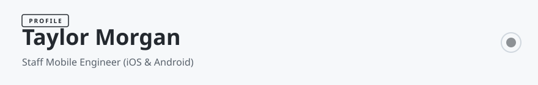

<!-- readmy:template=004-mobile-developer;version=2.0.0;components=banner@2.0.0,identity@2.0.0,metrics@2.0.0,prose@2.0.0,tech-badges@2.0.0,stack@2.0.0,projects@2.0.0,principles@2.0.0,links@2.0.0,colophon@2.0.0 -->

<picture>
  <source media="(prefers-color-scheme: dark)" srcset="./assets/banner-dark.svg" />
  <source media="(prefers-color-scheme: light)" srcset="./assets/banner-light.svg" />
  
</picture>

<h1>Taylor Morgan</h1>

Staff Mobile Engineer (iOS &amp; Android)

<!-- section:organization omitted : missing field -->
<!-- section:location omitted : missing field -->

<table width="100%">
<tbody>
  <tr>
    <td width="33%" align="center">
      <h4>4.9 ★ (84k)</h4>
      
<strong>App Store Rating</strong> <small>Swift &amp; SwiftUI</small>

    </td>
    <td width="33%" align="center">
      <h4>4.8 ★ (120k)</h4>
      
<strong>Google Play Rating</strong> <small>Kotlin &amp; Compose</small>

    </td>
    <td width="33%" align="center">
      <h4>99.94%</h4>
      
<strong>Crash-Free Users</strong> <small>3.4M+ Monthly Active Users</small>

    </td>
  </tr>
</tbody>
</table>

<h2>Overview</h2>

I architect high-performance, 120Hz native mobile applications with offline-first synchronization and sub-100ms startup times.

SwiftUI Composable Architecture (TCA), Jetpack Compose, Kotlin Multiplatform (KMP), and ultra-low-latency BLE peripherals.

<h2>Technologies</h2>
<picture>
  <source media="(prefers-color-scheme: dark)" srcset="./assets/tech-badges-dark.svg" />
  <source media="(prefers-color-scheme: light)" srcset="./assets/tech-badges-light.svg" />
  
</picture>

<h2>Stack</h2>
<ul>
<li><strong>Native iOS &amp; Android</strong> — Swift, Kotlin, iOS, Android</li>
<li><strong>Cross-Platform &amp; Hybrid</strong> — Flutter, Dart, React</li>
</ul>

<h2>Projects</h2>
<table width="100%">
<tbody>
  <tr>
    <td width="50%" valign="top">
      <h3><a href="https://github.com/example-user/pulseflow-ios">PulseFlow-iOS</a></h3>
      
Native iOS vitals telemetry application with Apple HealthKit background sync and real-time ECG analysis.

      
 · <code>Swift</code> · ★ 2450

    </td>
    <td width="50%" valign="top">
      <h3><a href="https://github.com/example-user/omnipay-android">OmniPay-Terminal</a></h3>
      
Point-of-sale Android application with NFC Tap-to-Pay hardware daemon and offline transaction queue.

      
 · <code>Kotlin</code> · ★ 1980

    </td>
  </tr>
</tbody>
</table>

<h2>Principles</h2>
<ul>
<li>120 FPS frame drops are bugs: hitch rates must stay strictly below 0.1%.</li>
<li>Offline-first is table stakes: mobile networks are intermittent by default.</li>
<li>Preserve device battery: background jobs must coalesce into batch execution windows.</li>
</ul>

<h2>Links</h2>

<a href="https://github.com/example-user">GitHub</a> · <a href="https://apple.com">App Store</a> · <a href="https://play.google.com">Google Play</a>

Profile generated by ReadMy 004-mobile-developer 2.0.0. Local SVG assets, zero third-party services.

