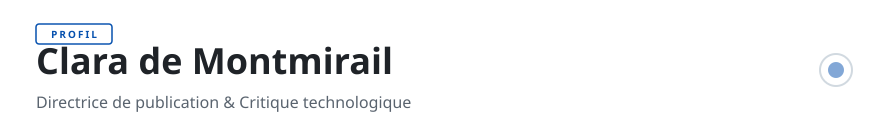

<!-- readmy:template=013-magazine-editorial;version=2.0.0;composants=banner@2.0.0,identity@2.0.0,prose@2.0.0,publications@2.0.0,projects@2.0.0,principles@2.0.0,links@2.0.0,colophon@2.0.0 -->

<picture>
  <source media="(prefers-color-scheme: dark)" srcset="./assets/banner-dark.svg" />
  <source media="(prefers-color-scheme: light)" srcset="./assets/banner-light.svg" />
  
</picture>

<h1>Clara de Montmirail</h1>

Directrice de publication &amp; Critique technologique

<!-- section:organisation omise : champ absent -->
<!-- section:lieu omise : champ absent -->

<h2>En bref</h2>

J'écris sur les frictions entre systèmes computationnels et écologie politique. Chroniques, essais et typographie soignée.

Enquêtes sur la sobriété numérique, l'éthique logicielle et la durabilité des artefacts ouverts.

<h2>Publications</h2>
<table>
<thead><tr><th>Année</th><th>Titre</th><th>Support</th></tr></thead>
<tbody>
<tr><td>2026</td><td><a href="https://example.com/notes/vitesse">L'illusion de la vitesse infinie dans le Cloud</a></td><td>Revue Critique des Systèmes</td></tr>
<tr><td>2025</td><td><a href="https://example.com/notes/typographie">Typographie et lisibilité des interfaces publiques</a></td><td>Cahiers d'Ergonomie Numérique</td></tr>
</tbody>
</table>

<h2>Projets</h2>
<ul>
<li><a href="https://github.com/example-user/gazette">Gazette-OpenSource</a> — Moteur de publication statique minimaliste privilégiant les fontes système et l'encre numérique. · HTML · 640 étoiles</li>
<li><a href="https://github.com/example-user/manifeste">Manifeste-Sobriete</a> — Recueil d'essais collaboratifs sur la longévité des outils logiciels. · Markdown · 1200 étoiles</li>
</ul>

<h2>Principes</h2>
<ul>
<li>Un texte clair vaut mieux qu'une interface complexe.</li>
<li>La typographie n'est pas un ornement, c'est la structure même de la pensée.</li>
<li>La longévité d'un document se mesure à son indépendance envers les serveurs distants.</li>
</ul>

<h2>Liens</h2>

<a href="https://example.com">Essais &amp; Revue</a> · <a href="https://github.com/example-user">GitHub</a> · <a href="https://example.com/lettre">Lettre mensuelle</a>

Profil généré par ReadMy 013-magazine-editorial 2.0.0. Images SVG locales, aucun service tiers.

