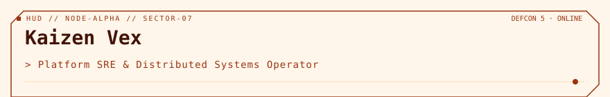

<!-- readmy:template=014-neon-command-center;version=2.0.0;composants=banner@2.0.0,identity@2.0.0,metrics@2.0.0,prose@2.0.0,stack@2.0.0,projects@2.0.0,principles@2.0.0,links@2.0.0,colophon@2.0.0 -->

<picture>
  <source media="(prefers-color-scheme: dark)" srcset="./assets/banner-dark.svg" />
  <source media="(prefers-color-scheme: light)" srcset="./assets/banner-light.svg" />
  
</picture>

<h1>Kaizen Vex</h1>

Platform SRE &amp; Distributed Systems Operator

<!-- section:organisation omise : champ absent -->
<!-- section:lieu omise : champ absent -->

<table width="100%">
<tbody>
  <tr>
    <td width="25%" align="center">
      <h4>64 Nodes</h4>
      
<strong>Core Cluster</strong> <small>Kubernetes 1.31 / eBPF</small>

    </td>
    <td width="25%" align="center">
      <h4>1.4M msg/s</h4>
      
<strong>Ingestion Rate</strong> <small>Kafka 0% lag</small>

    </td>
    <td width="25%" align="center">
      <h4>p99 &lt; 1.8ms</h4>
      
<strong>Tail Latency</strong> <small>Global edge dispatch</small>

    </td>
    <td width="25%" align="center">
      <h4>99.995%</h4>
      
<strong>Uptime</strong> <small>DEFCON 5 NORMAL</small>

    </td>
  </tr>
</tbody>
</table>

<h2>En bref</h2>

J'automatise les plateformes distribuées auto-réparatrices, élimine le travail répétitif et maintiens le consensus sous partition réseau hostile.

Inspection de paquets au niveau noyau Linux via eBPF XDP et consensus Raft vectorisé.

<h2>Stack</h2>
<ul>
<li><strong>Compute &amp; Runtime</strong> — Kubernetes, Cilium eBPF, Linux Kernel, WASM</li>
<li><strong>Distributed Data</strong> — Apache Kafka, ClickHouse, ScyllaDB, Redis</li>
</ul>

<h2>Projets</h2>
<table width="100%">
<tbody>
  <tr>
    <td width="50%" valign="top">
      <h3><a href="https://github.com/example-user/sentinel">Operation-Sentinel</a></h3>
      
Démon d'inspection de paquets au niveau noyau rejetant 10M pps avant allocation de socket.

      
 · <code>Rust</code> · ★ 2400

    </td>
    <td width="50%" valign="top">
      <h3><a href="https://github.com/example-user/chronoflux">Operation-ChronoFlux</a></h3>
      
Moteur de réplication WAL distribué sur consensus Raft avec zéro événement split-brain.

      
 · <code>Go</code> · ★ 1950

    </td>
  </tr>
</tbody>
</table>

<h2>Principes</h2>
<ul>
<li>Automatiser la remédiation avant qu'une alerte ne réveille un humain.</li>
<li>Une architecture sans test de chaos engineering est fragile par définition.</li>
<li>Le zero-trust n'est pas négociable : mTLS via SPIRE/SPIFFE systématique.</li>
</ul>

<h2>Liens</h2>

<a href="https://github.com/example-user">GitHub</a> · <a href="https://example.com/telemetry">Grafana Dashboards</a> · <a href="https://example.com/incidents">Incident Log</a>

Profil généré par ReadMy 014-neon-command-center 2.0.0. Images SVG locales, aucun service tiers.

