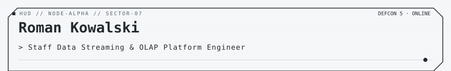
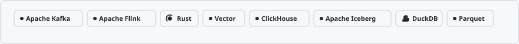

<!-- readmy:template=016-data-dashboard;version=2.0.0;components=banner@2.0.0,identity@2.0.0,metrics@2.0.0,prose@2.0.0,tech-badges@2.0.0,stack@2.0.0,projects@2.0.0,principles@2.0.0,links@2.0.0,colophon@2.0.0 -->

<picture>
  <source media="(prefers-color-scheme: dark)" srcset="./assets/banner-dark.svg" />
  <source media="(prefers-color-scheme: light)" srcset="./assets/banner-light.svg" />
  
</picture>

<h1>Roman Kowalski</h1>

Staff Data Streaming &amp; OLAP Platform Engineer

<!-- section:organization omitted : missing field -->
<!-- section:location omitted : missing field -->

<table width="100%">
<tbody>
  <tr>
    <td width="25%" align="center">
      <h4>3.8M / s</h4>
      
<strong>Events / Sec</strong> <small>Kafka Cluster 120 Partitions</small>

    </td>
    <td width="25%" align="center">
      <h4>&lt; 8ms</h4>
      
<strong>Ingestion Latency</strong> <small>End-to-End Pipeline</small>

    </td>
    <td width="25%" align="center">
      <h4>45 TB / day</h4>
      
<strong>Daily Ingestion</strong> <small>ClickHouse Tiering</small>

    </td>
    <td width="25%" align="center">
      <h4>84 Active</h4>
      
<strong>Active Flink Jobs</strong> <small>Exactly-Once Semantics</small>

    </td>
  </tr>
</tbody>
</table>

<h2>Overview</h2>

I build real-time data backbones: distributed streaming, exactly-once delivery guarantees, and sub-second analytical queries.

Apache Flink topology tuning, ClickHouse table partitioning, and Apache Iceberg catalog formats on object storage.

<h2>Technologies</h2>
<picture>
  <source media="(prefers-color-scheme: dark)" srcset="./assets/tech-badges-dark.svg" />
  <source media="(prefers-color-scheme: light)" srcset="./assets/tech-badges-light.svg" />
  
</picture>

<h2>Stack</h2>
<ul>
<li><strong>Streaming Engine</strong> — Apache Kafka, Apache Flink, Rust, Vector</li>
<li><strong>Analytics &amp; Storage</strong> — ClickHouse, Apache Iceberg, DuckDB, Parquet</li>
</ul>

<h2>Projects</h2>
<table width="100%">
<tbody>
  <tr>
    <td width="50%" valign="top">
      <h3><a href="https://github.com/example-user/flink-sink">Flink-Delta-Sink</a></h3>
      
High-performance Flink connector for zero-compaction streaming ingestion into Iceberg tables.

      
 · <code>Java</code> · ★ 1290

    </td>
    <td width="50%" valign="top">
      <h3><a href="https://github.com/example-user/ch-proxy">Fast-ClickHouse-Proxy</a></h3>
      
Load-balancing and analytical query caching proxy with concurrent query deduplication.

      
 · <code>Go</code> · ★ 870

    </td>
  </tr>
</tbody>
</table>

<h2>Principles</h2>
<ul>
<li>Ingestion latency is lost in needless serialization: embrace Arrow and FlatBuffers.</li>
<li>Every event schema must be contract-tested and validated before hitting a topic.</li>
<li>Any data unqueried after 90 days belongs in cold archive tiers.</li>
</ul>

<h2>Links</h2>

<a href="https://github.com/example-user">GitHub</a> · <a href="https://example.com/data-metrics">Data Observability</a> · <a href="https://example.com/notes">Architecture Notes</a>

Profile generated by ReadMy 016-data-dashboard 2.0.0. Local SVG assets, zero third-party services.

