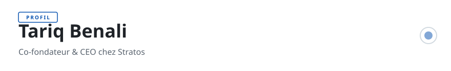

<!-- readmy:template=024-pitch-deck;version=2.0.0;composants=banner@2.0.0,identity@2.0.0,metrics@2.0.0,pitch@2.0.0,projects@2.0.0,principles@2.0.0,links@2.0.0,colophon@2.0.0 -->

<picture>
  <source media="(prefers-color-scheme: dark)" srcset="./assets/banner-dark.svg" />
  <source media="(prefers-color-scheme: light)" srcset="./assets/banner-light.svg" />
  
</picture>

<h1>Tariq Benali</h1>

Co-fondateur &amp; CEO chez Stratos

<!-- section:organisation omise : champ absent -->
<!-- section:lieu omise : champ absent -->

<table width="100%">
<tbody>
  <tr>
    <td width="25%" align="center">
      <h4>1.2M€</h4>
      
<strong>ARR</strong> <small>+180% YoY</small>

    </td>
    <td width="25%" align="center">
      <h4>450+</h4>
      
<strong>Clients Actifs</strong> <small>Entreprises Mid-Market</small>

    </td>
    <td width="25%" align="center">
      <h4>124%</h4>
      
<strong>Net Retention</strong> <small>Cohort 2025</small>

    </td>
    <td width="25%" align="center">
      <h4>14 pers.</h4>
      
<strong>Équipe</strong> <small>Paris &amp; Remote</small>

    </td>
  </tr>
</tbody>
</table>

<h2>Offre</h2>

Les équipes d'ingénierie perdent 30% de leur bande passante sur des pipelines CI/CD instables et des environnements éphémères mal orchestrés.

Stratos fournit des bacs à sable de test instantanés, isolés et auto-nettoyés à chaque pull request, sans configuration manuelle.

Plus de 450 clients en production réduisent leur délai de livraison de 4 jours à 40 minutes avec un ROI constaté dès le premier mois.

<h2>Projets</h2>
<table width="100%">
<tbody>
  <tr>
    <td width="50%" valign="top">
      <h3><a href="https://github.com/example-user/stratos-cli">Stratos-CLI</a></h3>
      
Interface en ligne de commande pour provisionner des environnements éphémères en 4 secondes.

      
 · <code>TypeScript</code> · ★ 2100

    </td>
    <td width="50%" valign="top">
      <h3><a href="https://github.com/example-user/sandbox-engine">Ephemeral-Sandbox</a></h3>
      
Orchestrateur de conteneurs légers avec isolation réseau stricte et zéro résidu sur disque.

      
 · <code>Go</code> · ★ 3450

    </td>
  </tr>
</tbody>
</table>

<h2>Principes</h2>
<ul>
<li>L'exécution rapide et disciplinée bat l'idée brillante.</li>
<li>Écouter les clients jusqu'à ce que le point de douleur soit évident.</li>
<li>Bâtir pour durer : rentabilité unitaire dès le premier jour.</li>
</ul>

<h2>Liens</h2>

<a href="https://example.com/stratos">Découvrir Stratos</a> · <a href="https://example.com/deck">Dossier Investisseurs</a> · <a href="https://github.com/example-user">GitHub</a>

Profil généré par ReadMy 024-pitch-deck 2.0.0. Images SVG locales, aucun service tiers.

