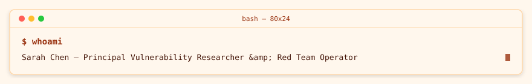

<!-- readmy:template=025-security-lab;version=2.0.0;components=banner@2.0.0,identity@2.0.0,prose@2.0.0,tech-badges@2.0.0,checklist@2.0.0,projects@2.0.0,principles@2.0.0,links@2.0.0,colophon@2.0.0 -->

<picture>
  <source media="(prefers-color-scheme: dark)" srcset="./assets/banner-dark.svg" />
  <source media="(prefers-color-scheme: light)" srcset="./assets/banner-light.svg" />
  
</picture>

<h1>Sarah Chen</h1>

Principal Vulnerability Researcher &amp; Red Team Operator

<!-- section:organization omitted : missing field -->
<!-- section:location omitted : missing field -->

<h2>Overview</h2>

I hunt authentication logic bypasses, memory safety vulnerabilities, and cloud privilege escalation vectors.

Multi-tenant Kubernetes security reviews, SELinux/AppArmor enforcement, and coordinated CVE disclosures.

<h2>Technologies</h2>
<picture>
  <source media="(prefers-color-scheme: dark)" srcset="./assets/tech-badges-dark.svg" />
  <source media="(prefers-color-scheme: light)" srcset="./assets/tech-badges-light.svg" />
  
</picture>

<h2>Roadmap</h2>
<ul>
<li><strong>done</strong> — Zero-trust CI/CD pipeline supply chain audit</li>
<li><strong>in progress</strong> — Confidential VM enclave isolation research</li>
<li><strong>planned</strong> — Container runtime kernel hardening guide publication</li>
</ul>

<h2>Projects</h2>
<table>
<thead><tr><th>Project</th><th>Description</th><th>Language</th><th>Stars</th></tr></thead>
<tbody>
<tr><td><a href="https://github.com/example-user/kube-hardener">Kube-Hardener</a></td><td>Automated CIS benchmark policy audit engine with remediation hooks.</td><td>Go</td><td>2150</td></tr>
<tr><td><a href="https://github.com/example-user/mem-fuzzer">Memory-Fuzzer-Lite</a></td><td>Coverage-guided binary protocol fuzzer without heavy binary instrumentation.</td><td>C</td><td>1680</td></tr>
</tbody>
</table>

<h2>Principles</h2>
<ul>
<li>Security through obscurity is a postponement, never a safeguard.</li>
<li>Coordinated disclosure prioritizes user safety above all.</li>
<li>Reducing the attack surface is infinitely better than triage alerts.</li>
</ul>

<h2>Links</h2>

<a href="https://github.com/example-user">GitHub</a> · <a href="https://example.com/cve">Security Advisories</a> · <a href="https://example.com/security-pgp">PGP Public Key</a>

Profile generated by ReadMy 025-security-lab 2.0.0. Local SVG assets, zero third-party services.

