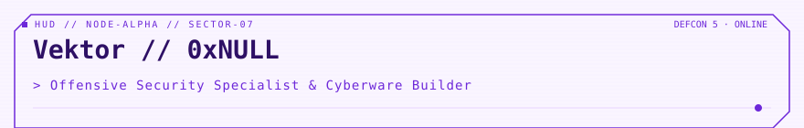

<!-- readmy:template=031-cyberpunk-netrunner;version=2.0.0;composants=banner@2.0.0,identity@2.0.0,prose@2.0.0,stack@2.0.0,projects@2.0.0,checklist@2.0.0,links@2.0.0,colophon@2.0.0 -->

<picture>
  <source media="(prefers-color-scheme: dark)" srcset="./assets/banner-dark.svg" />
  <source media="(prefers-color-scheme: light)" srcset="./assets/banner-light.svg" />
  
</picture>

<h1>Vektor // 0xNULL</h1>

Offensive Security Specialist &amp; Cyberware Builder

<!-- section:organisation omise : champ absent -->
<!-- section:lieu omise : champ absent -->

<h2>En bref</h2>

Spécialisé dans le reverse engineering de microprogrammes, l'analyse de protocoles matériels et l'intrusion par radio logicielle.

Exploitation de failles d'isolation mémoire, injection de fautes et analyse de canaux auxiliaires.

<h2>Stack</h2>
<ul>
<li><strong>Cyber Deck</strong> — Ghidra, Radare2, IDA Pro, QEMU</li>
<li><strong>Hardware Weapons</strong> — HackRF One, Bus Pirate, Flipper Zero, JTAGulator</li>
</ul>

<h2>Projets</h2>
<table width="100%">
<tbody>
  <tr>
    <td width="50%" valign="top">
      <h3><a href="https://github.com/example-user/ghost-firmware">GhostInTheFirmware</a></h3>
      
Framework d'émulation et de fuzzing de firmwares UEFI/ARM bare-metal.

      
 · <code>C</code> · ★ 1250

    </td>
    <td width="50%" valign="top">
      <h3><a href="https://github.com/example-user/blackice">BlackICE-Detector</a></h3>
      
Sonde de détection passive de backdoors physiques sur bus CAN et SPI.

      
 · <code>Rust</code> · ★ 890

    </td>
  </tr>
</tbody>
</table>

<h2>Feuille de route</h2>
<ul>
<li><strong>fait</strong> — Audit de sécurité firmware satellite</li>
<li><strong>en cours</strong> — Fuzzing de pilote USB noyau</li>
<li><strong>prévu</strong> — Publication advisory zero-day contrôleur industriel</li>
</ul>

<h2>Liens</h2>

<a href="https://github.com/example-user">GitHub</a> · <a href="https://example.com/advisories">Advisories</a> · <a href="https://example.com/pgp">PGP Key</a>

Profil généré par ReadMy 031-cyberpunk-netrunner 2.0.0. Images SVG locales, aucun service tiers.

