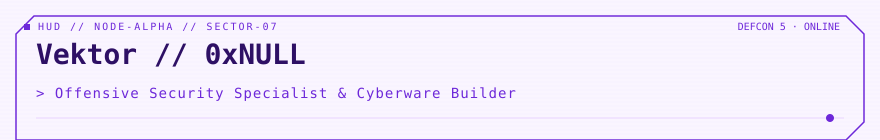

<!-- readmy:template=031-cyberpunk-netrunner;version=2.0.0;components=banner@2.0.0,identity@2.0.0,prose@2.0.0,tech-badges@2.0.0,stack@2.0.0,projects@2.0.0,checklist@2.0.0,links@2.0.0,colophon@2.0.0 -->

<picture>
  <source media="(prefers-color-scheme: dark)" srcset="./assets/banner-dark.svg" />
  <source media="(prefers-color-scheme: light)" srcset="./assets/banner-light.svg" />
  
</picture>

<table width="100%">
<tbody>
  <tr>
    <td width="70%">
      <code>╔═══════════════════════════════════════════════════════════╗</code> 
      <code>║ NODE : Vektor // 0xNULL            [DECK STATUS: ONLINE]   ║</code> 
      <code>║ CLASS: Offensive Security Specialist &amp; Cyberware Builder    ║</code> 
      <code>╚═══════════════════════════════════════════════════════════╝</code>
    </td>
    <td width="30%" align="right">
      <code>SIGNAL: 99.8% [SYNC]</code> 
      <code>NEURAL LINK: LOCKED</code> 
      <code>ICE STATUS: BREACHED</code>
    </td>
  </tr>
</tbody>
</table>
<h1>Vektor // 0xNULL</h1>

Offensive Security Specialist &amp; Cyberware Builder

<h2>Deck Initialization &amp; Vectors</h2>
<blockquote>Specialized in firmware reverse engineering, low-level hardware bus introspection, and software-defined radio analysis.</blockquote>

<code>&gt;&gt; VECTORS:</code> Memory isolation bypasses, glitch fault injection, and physical side-channel leak analysis.

<h2>Technologies</h2>
<picture>
  <source media="(prefers-color-scheme: dark)" srcset="./assets/tech-badges-dark.svg" />
  <source media="(prefers-color-scheme: light)" srcset="./assets/tech-badges-light.svg" />
  
</picture>

<h2>Cyberware &amp; Arsenal</h2>
<table width="100%">
<thead><tr><th align="left">Cyber Deck</th><th align="left">Hardware Weapons</th></tr></thead>
<tbody>
  <tr>
    <td valign="top"><code>Ghidra</code> · <code>Radare2</code> · <code>IDA Pro</code> · <code>QEMU</code></td>
    <td valign="top"><code>HackRF One</code> · <code>Bus Pirate</code> · <code>Flipper Zero</code> · <code>JTAGulator</code></td>
  </tr>
</tbody>
</table>

<h2>Exploits &amp; System Penetrations</h2>
<table width="100%">
<tbody>
  <tr>
    <td width="50%" valign="top">
      <h3><code>[ROOTKIT]</code> <a href="https://github.com/example-user/ghost-firmware">GhostInTheFirmware</a></h3>
      <blockquote>Emulation and fuzzing framework for bare-metal UEFI/ARM vendor firmwares.</blockquote>
      
 · <code>C</code> · ★ 1250 · <code>DEFCON_TALK_VERIFIED</code>

    </td>
    <td width="50%" valign="top">
      <h3><code>[DAEMON]</code> <a href="https://github.com/example-user/blackice">BlackICE-Detector</a></h3>
      <blockquote>Passive intrusion detection probe intercepting anomalies across CAN and SPI buses.</blockquote>
      
 · <code>Rust</code> · ★ 890 · <code>HARDWARE_VERIFIED</code>

    </td>
  </tr>
</tbody>
</table>

<h2>Roadmap</h2>

<b>[+] DECRYPT RUNTIME LOGS &amp; PENETRATION ROADMAP</b>

<ul>
<li><code>[✓]</code> <strong>done</strong> — Satellite downlink telemetry firmware review</li>
<li><code>[⚡]</code> <strong>in progress</strong> — Host USB kernel driver differential fuzzing</li>
<li><code>[⏳]</code> <strong>planned</strong> — Industrial SCADA zero-day coordination release</li>
</ul>

<h2>Links</h2>

<a href="https://github.com/example-user">GitHub</a> · <a href="https://example.com/advisories">Advisories</a> · <a href="https://example.com/pgp">PGP Key</a>

Profile generated by ReadMy 031-cyberpunk-netrunner 2.0.0. Local SVG assets, zero third-party services.

