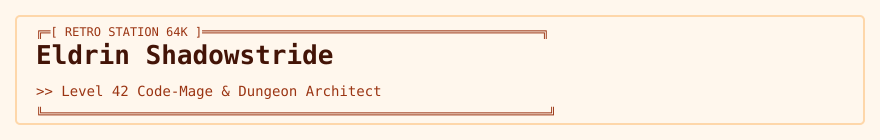

<!-- readmy:template=033-dungeon-rpg-character-sheet;version=2.0.0;components=banner@2.0.0,identity@2.0.0,metrics@2.0.0,prose@2.0.0,tech-badges@2.0.0,stack@2.0.0,projects@2.0.0,checklist@2.0.0,links@2.0.0,colophon@2.0.0 -->

<picture>
  <source media="(prefers-color-scheme: dark)" srcset="./assets/banner-dark.svg" />
  <source media="(prefers-color-scheme: light)" srcset="./assets/banner-light.svg" />
  
</picture>

<pre><code>┌─────────────────────────────────────────────────────────────────────────────┐
│ CHARACTER: ELDRIN SHADOWSTRIDE              CLASS: LEVEL 80 ARCHMAGE │
│ RACE: OPEN-SOURCE GNOME                           ALIGNMENT: CHAOTIC LAWFUL │
│ HP: [████████████████████░░░░] 85/100             MANA: [████████████████████] 100/100 │
└─────────────────────────────────────────────────────────────────────────────┘</code></pre>
<h1>Eldrin Shadowstride</h1>

Level 42 Code-Mage &amp; Dungeon Architect

<h2>Ability Scores &amp; Character Stats</h2>
<table width="100%">
<thead><tr><th align="center">STR (RAM)</th><th align="center">DEX (Latency)</th><th align="center">CON (Uptime)</th><th align="center">INT (Algorithms)</th></tr></thead>
<tbody>
  <tr>
    <td align="center">
      <b>18 (+4)</b> 
      <small>STR (RAM)</small>
    </td>
    <td align="center">
      <b>20 (+5)</b> 
      <small>DEX (Latency)</small>
    </td>
    <td align="center">
      <b>22 (+6)</b> 
      <small>CON (Uptime)</small>
    </td>
    <td align="center">
      <b>142 / 142</b> 
      <small>INT (Algorithms)</small>
    </td>
  </tr>
</tbody>
</table>

<h2>Overview</h2>

I explore legacy codebase dungeons, disarm concurrency traps, and slay memory leak dragons.

Zero-allocation Rust incantations and low-level LLVM compiler sorcery.

<h2>Technologies</h2>
<picture>
  <source media="(prefers-color-scheme: dark)" srcset="./assets/tech-badges-dark.svg" />
  <source media="(prefers-color-scheme: light)" srcset="./assets/tech-badges-light.svg" />
  
</picture>

<h2>Stack</h2>
<ul>
<li><strong>Spellbook &amp; Grimoires</strong> — Rust, C++20, Haskell, Assembly x86</li>
<li><strong>Enchanted Artifacts</strong> — Neovim, Valgrind, GDB, Perf</li>
</ul>

<h2>Grimoire of Spells &amp; Legendary Relics</h2>
<table width="100%">
<tbody>
  <tr>
    <td width="50%" valign="top">
      <h3>⚔️ <a href="https://github.com/example-user/vorpal">Vorpal-Compiler</a></h3>
      
<b>[Relic / Spell]</b> JIT compiler generating vectorized machine code for fantasy scripting languages.

      
 · <code>Rust</code> · ★ 780 Gold

    </td>
    <td width="50%" valign="top">
      <h3>🔮 <a href="https://github.com/example-user/mithril">Mithril-Engine</a></h3>
      
<b>[Ancient Tome]</b> Lightweight ASCII rendering engine for terminal-based roguelike RPGs.

      
 · <code>C</code> · ★ 1120 Gold

    </td>
  </tr>
</tbody>
</table>

<h2>Active Quests &amp; Dungeon Raids</h2>
<ul>
<li><strong>[x]</strong> <i>(done)</i> Purge the catacombs of legacy technical debt</li>
<li><strong>[/]</strong> <i>(in progress)</i> Forge full-coverage integration test armor</li>
<li><strong>[ ]</strong> <i>(planned)</i> Conquer the distributed microservices dungeon</li>
</ul>

<h2>Links</h2>

<a href="https://github.com/example-user">Guild Registry</a> · <a href="https://example.com/character">Character Sheet</a> · <a href="https://example.com/spells">Grimoire</a>

Profile generated by ReadMy 033-dungeon-rpg-character-sheet 2.0.0. Local SVG assets, zero third-party services.

