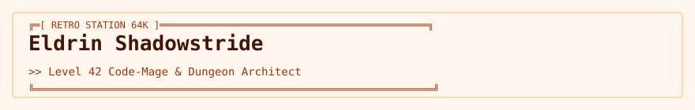

<!-- readmy:template=033-dungeon-rpg-character-sheet;version=2.0.0;composants=banner@2.0.0,identity@2.0.0,metrics@2.0.0,prose@2.0.0,stack@2.0.0,projects@2.0.0,checklist@2.0.0,links@2.0.0,colophon@2.0.0 -->

<picture>
  <source media="(prefers-color-scheme: dark)" srcset="./assets/banner-dark.svg" />
  <source media="(prefers-color-scheme: light)" srcset="./assets/banner-light.svg" />
  
</picture>

<h1>Eldrin Shadowstride</h1>

Level 42 Code-Mage &amp; Dungeon Architect

<!-- section:organisation omise : champ absent -->
<!-- section:lieu omise : champ absent -->

<table width="100%">
<tbody>
  <tr>
    <td width="25%" align="center">
      <h4>18 (+4)</h4>
      
<strong>FOR / STR</strong> <small>Compiler Heavy Lifting</small>

    </td>
    <td width="25%" align="center">
      <h4>20 (+5)</h4>
      
<strong>DEX / AGI</strong> <small>Fast Refactoring Speed</small>

    </td>
    <td width="25%" align="center">
      <h4>22 (+6)</h4>
      
<strong>INT / MANA</strong> <small>Algorithm Optimization</small>

    </td>
    <td width="25%" align="center">
      <h4>142 / 142</h4>
      
<strong>PV / HP</strong> <small>Max Resilience</small>

    </td>
  </tr>
</tbody>
</table>

<h2>En bref</h2>

J'arpente les donjons des bases de code legacy, désamorce les pièges de concurrence et terrasse les dragons de fuite mémoire.

Spécialisation dans les incantations Rust sans allocation dynamique et la magie des compilateurs LLVM.

<h2>Stack</h2>
<ul>
<li><strong>Spellbook &amp; Grimoires</strong> — Rust, C++20, Haskell, Assembly x86</li>
<li><strong>Enchanted Artifacts</strong> — Neovim, Valgrind, GDB, Perf</li>
</ul>

<h2>Projets</h2>
<table width="100%">
<tbody>
  <tr>
    <td width="50%" valign="top">
      <h3><a href="https://github.com/example-user/vorpal">Vorpal-Compiler</a></h3>
      
Compilateur JIT de langage fantastique produisant du code machine vectorisé.

      
 · <code>Rust</code> · ★ 780

    </td>
    <td width="50%" valign="top">
      <h3><a href="https://github.com/example-user/mithril">Mithril-Engine</a></h3>
      
Moteur de rendu ASCII pour jeux de rôle textuels dans un terminal Unix.

      
 · <code>C</code> · ★ 1120

    </td>
  </tr>
</tbody>
</table>

<h2>Feuille de route</h2>
<ul>
<li><strong>fait</strong> — Nettoyer les catacombes de la dette technique</li>
<li><strong>en cours</strong> — Forger l'armure de tests d'intégration</li>
<li><strong>prévu</strong> — Conquérir le donjon des microservices</li>
</ul>

<h2>Liens</h2>

<a href="https://github.com/example-user">Guild Registry</a> · <a href="https://example.com/character">Character Sheet</a> · <a href="https://example.com/spells">Grimoire</a>

Profil généré par ReadMy 033-dungeon-rpg-character-sheet 2.0.0. Images SVG locales, aucun service tiers.

