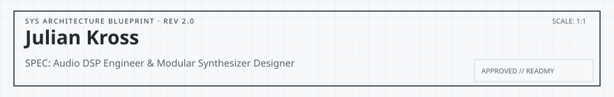

<!-- readmy:template=034-audio-synth-rack;version=2.0.0;components=banner@2.0.0,identity@2.0.0,prose@2.0.0,tech-badges@2.0.0,stack@2.0.0,projects@2.0.0,principles@2.0.0,links@2.0.0,colophon@2.0.0 -->

<picture>
  <source media="(prefers-color-scheme: dark)" srcset="./assets/banner-dark.svg" />
  <source media="(prefers-color-scheme: light)" srcset="./assets/banner-light.svg" />
  
</picture>

<h1>Julian Kross</h1>

Audio DSP Engineer &amp; Modular Synthesizer Designer

<!-- section:organization omitted : missing field -->
<!-- section:location omitted : missing field -->

<h2>Overview</h2>

I build hybrid analog/digital Eurorack modules, algorithmic reverb models, and real-time audio plugins.

Fixed-point digital signal processing, non-linear physical filter modeling, and jitter-free SIMD vectorization.

<h2>Technologies</h2>
<picture>
  <source media="(prefers-color-scheme: dark)" srcset="./assets/tech-badges-dark.svg" />
  <source media="(prefers-color-scheme: light)" srcset="./assets/tech-badges-light.svg" />
  
</picture>

<h2>Stack</h2>
<ul>
<li><strong>DSP &amp; Audio Frameworks</strong> — JUCE, FAUST, C++23, PureData</li>
<li><strong>Hardware &amp; Embedded</strong> — STM32 ARM Cortex-M7, Daisy Seed, KiCad, Eurorack</li>
</ul>

<h2>Projects</h2>
<table width="100%">
<tbody>
  <tr>
    <td width="50%" valign="top">
      <h3><a href="https://github.com/example-user/resonator-core">Resonator-Core</a></h3>
      
Physical modal resonator modeling engine with sub-12-microsecond sample loop latency.

      
 · <code>C++</code> · ★ 960

    </td>
    <td width="50%" valign="top">
      <h3><a href="https://github.com/example-user/polymorph">Polymorph-Synth</a></h3>
      
Vector wavetable synthesizer featuring real-time granular synthesis engine.

      
 · <code>Rust</code> · ★ 1340

    </td>
  </tr>
</tbody>
</table>

<h2>Principles</h2>
<ul>
<li>Audio tolerates zero glitches: audio callback buffers preempt all UI tasks.</li>
<li>Analog hardware provides unique character; digital processing provides infinite precision.</li>
<li>A great musical instrument should remain completely playable without a monitor.</li>
</ul>

<h2>Links</h2>

<a href="https://example.com/audio">Audio Demos</a> · <a href="https://example.com/schematics">Hardware Schematics</a> · <a href="https://github.com/example-user">GitHub</a>

Profile generated by ReadMy 034-audio-synth-rack 2.0.0. Local SVG assets, zero third-party services.

