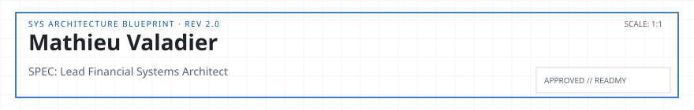

<!-- readmy:template=036-fintech-saas-builder;version=2.0.0;composants=banner@2.0.0,identity@2.0.0,metrics@2.0.0,prose@2.0.0,stack@2.0.0,projects@2.0.0,principles@2.0.0,links@2.0.0,colophon@2.0.0 -->

<picture>
  <source media="(prefers-color-scheme: dark)" srcset="./assets/banner-dark.svg" />
  <source media="(prefers-color-scheme: light)" srcset="./assets/banner-light.svg" />
  
</picture>

<h1>Mathieu Valadier</h1>

Lead Financial Systems Architect

<!-- section:organisation omise : champ absent -->
<!-- section:lieu omise : champ absent -->

<table width="100%">
<tbody>
  <tr>
    <td width="25%" align="center">
      <h4>2.4Mds€ / an</h4>
      
<strong>Volume Traité</strong> <small>Double-Entry Ledger</small>

    </td>
    <td width="25%" align="center">
      <h4>99.999%</h4>
      
<strong>Disponibilité SLA</strong> <small>Multi-Region Active/Active</small>

    </td>
    <td width="25%" align="center">
      <h4>&lt; 120ms</h4>
      
<strong>Temps de Clôture</strong> <small>Instant Settlement</small>

    </td>
    <td width="25%" align="center">
      <h4>PCI-DSS N1</h4>
      
<strong>Conformité</strong> <small>SOC2 Type II</small>

    </td>
  </tr>
</tbody>
</table>

<h2>En bref</h2>

Je conçois des moteurs de comptabilité transactionnelle immuable, des passerelles de paiement résilientes et des audits automatisés.

Idempotence stricte des requêtes financières, consensus distribué et détection d'anomalies en temps réel.

<h2>Stack</h2>
<ul>
<li><strong>Core Ledger</strong> — PostgreSQL, TigerBeetle, Kafka, Go</li>
<li><strong>Banking Protocols</strong> — ISO 20022, SEPA Instant, SWIFT, Open Banking API</li>
</ul>

<h2>Projets</h2>
<table width="100%">
<tbody>
  <tr>
    <td width="50%" valign="top">
      <h3><a href="https://github.com/example-user/immutable-ledger">Immutable-Ledger-Core</a></h3>
      
Grand livre comptable en partie double avec garanties ACID et audit cryptographique continu.

      
 · <code>Go</code> · ★ 1850

    </td>
    <td width="50%" valign="top">
      <h3><a href="https://github.com/example-user/settlement-engine">Settlement-Engine</a></h3>
      
Moteur de réconciliation bancaire automatisé traitant 100k opérations par minute sans divergence.

      
 · <code>Rust</code> · ★ 1420

    </td>
  </tr>
</tbody>
</table>

<h2>Principes</h2>
<ul>
<li>Dans les systèmes financiers, chaque centime et chaque arrondi doivent être prouvables.</li>
<li>L'idempotence n'est pas optionnelle : jamais deux débits pour un clic.</li>
<li>Les audits manuels sont des pannes en attente : tout vérifier par le code.</li>
</ul>

<h2>Liens</h2>

<a href="https://github.com/example-user">GitHub</a> · <a href="https://example.com/specs">Spécifications Techniques</a> · <a href="https://example.com/audits">Rapports d'Audit</a>

Profil généré par ReadMy 036-fintech-saas-builder 2.0.0. Images SVG locales, aucun service tiers.

