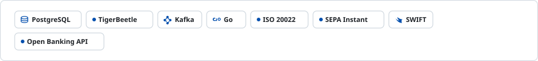

<!-- readmy:template=036-fintech-saas-builder;version=2.0.0;components=banner@2.0.0,identity@2.0.0,metrics@2.0.0,prose@2.0.0,tech-badges@2.0.0,stack@2.0.0,projects@2.0.0,principles@2.0.0,links@2.0.0,colophon@2.0.0 -->

<picture>
  <source media="(prefers-color-scheme: dark)" srcset="./assets/banner-dark.svg" />
  <source media="(prefers-color-scheme: light)" srcset="./assets/banner-light.svg" />
  
</picture>

<h1>Mathieu Valadier</h1>

Lead Financial Systems Architect

<!-- section:organization omitted : missing field -->
<!-- section:location omitted : missing field -->

<table width="100%">
<tbody>
  <tr>
    <td width="25%" align="center">
      <h4>$2.4B / year</h4>
      
<strong>Processed Volume</strong> <small>Double-Entry Ledger</small>

    </td>
    <td width="25%" align="center">
      <h4>99.999%</h4>
      
<strong>SLA Availability</strong> <small>Multi-Region Active/Active</small>

    </td>
    <td width="25%" align="center">
      <h4>&lt; 120ms</h4>
      
<strong>Settlement Time</strong> <small>Instant Settlement</small>

    </td>
    <td width="25%" align="center">
      <h4>PCI-DSS L1</h4>
      
<strong>Compliance Level</strong> <small>SOC2 Type II</small>

    </td>
  </tr>
</tbody>
</table>

<h2>Overview</h2>

I build immutable double-entry ledger platforms, mission-critical payment gateways, and automated reconciliation pipelines.

Strict financial idempotency, distributed consensus, and real-time ledger fraud anomaly detection.

<h2>Technologies</h2>
<picture>
  <source media="(prefers-color-scheme: dark)" srcset="./assets/tech-badges-dark.svg" />
  <source media="(prefers-color-scheme: light)" srcset="./assets/tech-badges-light.svg" />
  
</picture>

<h2>Stack</h2>
<ul>
<li><strong>Core Ledger</strong> — PostgreSQL, TigerBeetle, Kafka, Go</li>
<li><strong>Banking Protocols</strong> — ISO 20022, SEPA Instant, SWIFT, Open Banking API</li>
</ul>

<h2>Projects</h2>
<table width="100%">
<tbody>
  <tr>
    <td width="50%" valign="top">
      <h3><a href="https://github.com/example-user/immutable-ledger">Immutable-Ledger-Core</a></h3>
      
Double-entry transactional ledger with ACID guarantees and continuous cryptographic audit logs.

      
 · <code>Go</code> · ★ 1850

    </td>
    <td width="50%" valign="top">
      <h3><a href="https://github.com/example-user/settlement-engine">Settlement-Engine</a></h3>
      
Automated multi-currency bank reconciliation engine processing 100k records/min without ledger drift.

      
 · <code>Rust</code> · ★ 1420

    </td>
  </tr>
</tbody>
</table>

<h2>Principles</h2>
<ul>
<li>In financial architectures, every cent and rounding delta must be formally provable.</li>
<li>Idempotency keys are non-negotiable: never double-charge an account.</li>
<li>Manual audits are future outages waiting to happen: enforce everything in code.</li>
</ul>

<h2>Links</h2>

<a href="https://github.com/example-user">GitHub</a> · <a href="https://example.com/specs">Architecture Specs</a> · <a href="https://example.com/audits">Audit Reports</a>

Profile generated by ReadMy 036-fintech-saas-builder 2.0.0. Local SVG assets, zero third-party services.

