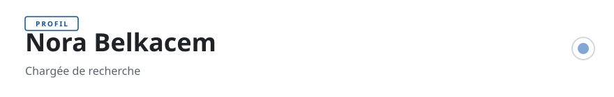

<!-- readmy:template=academic;version=2.0.0;components=banner@2.0.0,identity@2.0.0,prose@2.0.0,publications@2.0.0,links@2.0.0,colophon@2.0.0 -->

<picture>
  <source media="(prefers-color-scheme: dark)" srcset="./assets/banner-dark.svg" />
  <source media="(prefers-color-scheme: light)" srcset="./assets/banner-light.svg" />
  
</picture>

<h1>Nora Belkacem</h1>

Research Scientist

<!-- section:organization omitted : missing field -->
<!-- section:location omitted : missing field -->

<h2>Overview</h2>

I research the formal verification of distributed consensus protocols.

Formal proofs and reproducibility artifacts maintained in the same repository.

<h2>Publications</h2>
<table>
<thead><tr><th>Year</th><th>Title</th><th>Venue</th></tr></thead>
<tbody>
<tr><td>2025</td><td><a href="https://example.com/notes/horloges">Explicit Logical Clocks for Pedagogical Consensus</a></td><td>Journal of Distributed Systems Research</td></tr>
<tr><td>2024</td><td><a href="https://example.com/notes/tla-atelier">Annotated TLA+ Specifications for Fault-Tolerant Workshops</a></td><td>Symposium on Reliable Computing</td></tr>
</tbody>
</table>

<h2>Links</h2>

<a href="https://github.com/example-user">GitHub</a> · <a href="https://example.com/nora">Laboratory</a>

Profile generated by ReadMy academic 2.0.0. Local SVG assets, zero third-party services.

