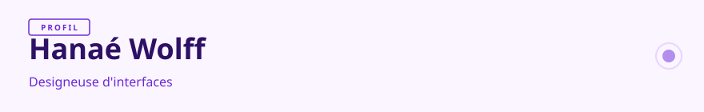
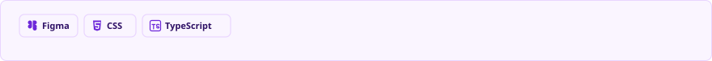

<!-- readmy:template=creator;version=2.0.0;components=banner@2.0.0,identity@2.0.0,prose@2.0.0,projects@2.0.0,tech-badges@2.0.0,stack@2.0.0,links@2.0.0,colophon@2.0.0 -->

<picture>
  <source media="(prefers-color-scheme: dark)" srcset="./assets/banner-dark.svg" />
  <source media="(prefers-color-scheme: light)" srcset="./assets/banner-light.svg" />
  
</picture>

<h1>Hanaé Wolff</h1>

Interface Designer

<!-- section:organization omitted : missing field -->
<!-- section:location omitted : missing field -->

<h2>Overview</h2>

I prototype clean, readable interfaces before introducing motion.

Accessible contrast, clear empty states, and responsive typography.

<h2>Projects</h2>
<table width="100%">
<tbody>
  <tr>
    <td width="50%" valign="top">
      <h3><a href="https://github.com/example-user/atelier">Atelier</a></h3>
      
Version-controlled design specifications for form systems.

      
 · <code>TypeScript</code>

    </td>
    <td width="50%" valign="top">
      <h3><a href="https://github.com/example-user/lisiere">Lisiere</a></h3>
      
Design pattern collection for application empty states and inline errors.

      
 · <code>CSS</code>

    </td>
  </tr>
</tbody>
</table>

<h2>Technologies</h2>
<picture>
  <source media="(prefers-color-scheme: dark)" srcset="./assets/tech-badges-dark.svg" />
  <source media="(prefers-color-scheme: light)" srcset="./assets/tech-badges-light.svg" />
  
</picture>

<h2>Stack</h2>
<ul>
<li><strong>Tools</strong> — Figma, CSS, TypeScript</li>
</ul>

<h2>Links</h2>

<a href="https://github.com/example-user">GitHub</a> · <a href="https://example.com/atelier">Portfolio</a>

Profile generated by ReadMy creator 2.0.0. Local SVG assets, zero third-party services.

