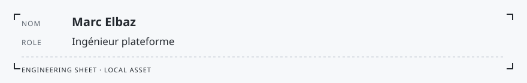
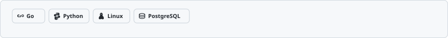

<!-- readmy:template=engineer;version=2.0.0;components=banner@2.0.0,identity@2.0.0,prose@2.0.0,principles@2.0.0,tech-badges@2.0.0,stack@2.0.0,projects@2.0.0,links@2.0.0,colophon@2.0.0 -->

<picture>
  <source media="(prefers-color-scheme: dark)" srcset="./assets/banner-dark.svg" />
  <source media="(prefers-color-scheme: light)" srcset="./assets/banner-light.svg" />
  
</picture>

<h1>Marc Elbaz</h1>

Platform Engineer

Atelier Nord

<!-- section:location omitted : missing field -->

<h2>Overview</h2>

I make deployment paths boring, and therefore safe.

Message queues, error budgets, and change review rigor.

<h2>Principles</h2>
<ul>
<li>An incident without written postmortem will repeat.</li>
<li>Friday's manual workaround becomes Saturday's outage.</li>
<li>Every alert must have a designated owner.</li>
</ul>

<h2>Technologies</h2>
<picture>
  <source media="(prefers-color-scheme: dark)" srcset="./assets/tech-badges-dark.svg" />
  <source media="(prefers-color-scheme: light)" srcset="./assets/tech-badges-light.svg" />
  
</picture>

<h2>Stack</h2>
<ul>
<li><strong>Languages</strong> — Go, Python</li>
<li><strong>Platform</strong> — Linux, PostgreSQL</li>
</ul>

<h2>Projects</h2>
<table width="100%">
<tbody>
  <tr>
    <td width="50%" valign="top">
      <h3><a href="https://github.com/example-user/quai">Quai</a></h3>
      
Migration orchestrator with explicit circuit-breaker shutdown.

      
 · <code>Go</code>

    </td>
    <td width="50%" valign="top">
      <h3><a href="https://github.com/example-user/balise">Balise</a></h3>
      
Latency telemetry probes for internal queues.

      
 · <code>Python</code>

    </td>
  </tr>
</tbody>
</table>

<h2>Links</h2>

<a href="https://github.com/example-user">GitHub</a> · <a href="https://example.com/quai">Notes</a>

Profile generated by ReadMy engineer 2.0.0. Local SVG assets, zero third-party services.

