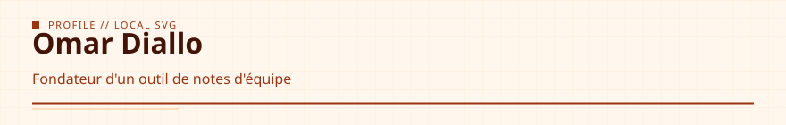

<!-- readmy:template=founder;version=2.0.0;components=banner@2.0.0,identity@2.0.0,pitch@2.0.0,projects@2.0.0,links@2.0.0,colophon@2.0.0 -->

<picture>
  <source media="(prefers-color-scheme: dark)" srcset="./assets/banner-dark.svg" />
  <source media="(prefers-color-scheme: light)" srcset="./assets/banner-light.svg" />
  
</picture>

<h1>Omar Diallo</h1>

Founder &amp; Product Engineer

<!-- section:organization omitted : missing field -->
<!-- section:location omitted : missing field -->

<h2>Pitch</h2>

Verbal team decisions vanish by the next meeting.

A collaborative log enforcing a decision, an assigned owner, and a date.

Public repository open-sourcing the note format and parser test suite.

<h2>Projects</h2>
<ul>
<li><a href="https://github.com/example-user/seance">Seance</a> — Structured plain-text specification for team decisions. · TypeScript</li>
</ul>

<h2>Links</h2>

<a href="https://github.com/example-user">GitHub</a> · <a href="https://example.com/seance">Product</a>

Profile generated by ReadMy founder 2.0.0. Local SVG assets, zero third-party services.

