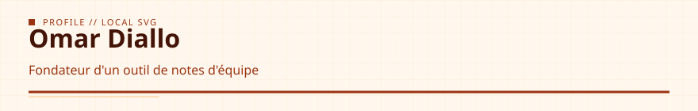

<!-- readmy:template=founder;version=2.0.0;components=banner@2.0.0,identity@2.0.0,pitch@2.0.0,projects@2.0.0,links@2.0.0,colophon@2.0.0 -->

<picture>
  <source media="(prefers-color-scheme: dark)" srcset="./assets/banner-dark.svg" />
  <source media="(prefers-color-scheme: light)" srcset="./assets/banner-light.svg" />
  
</picture>

<h1>Omar Diallo</h1>

Founder &amp; Product Engineer

<!-- section:organization omitted : missing field -->
<!-- section:location omitted : missing field -->

<h2>The Founder Manifesto</h2>
<table width="100%">
<tbody>
  <tr>
    <td width="33%" valign="top">
      <h3>1. What We Reject</h3>
      
Verbal team decisions vanish by the next meeting.

    </td>
    <td width="33%" valign="top">
      <h3>2. What We Build</h3>
      
A collaborative log enforcing a decision, an assigned owner, and a date.

    </td>
    <td width="33%" valign="top">
      <h3>3. Why Now</h3>
      
Public repository open-sourcing the note format and parser test suite.

    </td>
  </tr>
</tbody>
</table>

<h2>Projects</h2>
<ul>
<li><a href="https://github.com/example-user/seance">Seance</a> — Structured plain-text specification for team decisions. · TypeScript</li>
</ul>

<h2>Links</h2>

<a href="https://github.com/example-user">GitHub</a> · <a href="https://example.com/seance">Product</a>

Profile generated by ReadMy founder 2.0.0. Local SVG assets, zero third-party services.

