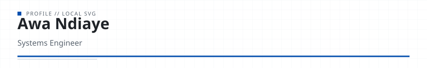

<!-- readmy:template=journey;version=2.0.0;components=banner@2.0.0,identity@2.0.0,prose@2.0.0,timeline@2.0.0,projects@2.0.0,links@2.0.0,colophon@2.0.0 -->

<picture>
  <source media="(prefers-color-scheme: dark)" srcset="./assets/banner-dark.svg" />
  <source media="(prefers-color-scheme: light)" srcset="./assets/banner-light.svg" />
  
</picture>

<h1>Awa Ndiaye</h1>

Systems Engineer

<!-- section:organization omitted : missing field -->

Lyon

<h2>Overview</h2>

I document the trajectory and lessons rather than a dry list of tools.

From application support to platform reliability, keeping postmortems transparent.

<h2>Timeline</h2>
<ul>
<li><strong>2018</strong> — Application Support Reproduce incidents locally before proposing production patches.</li>
<li><strong>2021</strong> — Platform Engineering Move release deployments behind managed queues and dual review.</li>
<li><strong>2024</strong> — Site Reliability Written error budgets and quarterly disaster recovery drills.</li>
</ul>

<h2>Projects</h2>
<ul>
<li><a href="https://github.com/example-user/reprise">Reprise</a> — Documented disaster recovery drill scenarios for relational stores. · Python</li>
</ul>

<h2>Links</h2>

<a href="https://github.com/example-user">GitHub</a> · <a href="https://example.com/journal">Journal</a>

Profile generated by ReadMy journey 2.0.0. Local SVG assets, zero third-party services.

