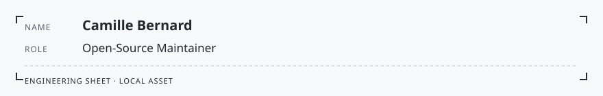

<!-- readmy:template=maintainer;version=2.0.0;components=banner@2.0.0,identity@2.0.0,prose@2.0.0,principles@2.0.0,projects@2.0.0,links@2.0.0,colophon@2.0.0 -->

<picture>
  <source media="(prefers-color-scheme: dark)" srcset="./assets/banner-dark.svg" />
  <source media="(prefers-color-scheme: light)" srcset="./assets/banner-light.svg" />
  
</picture>

<h1>Camille Bernard</h1>

Open-Source Maintainer

<!-- section:organization omitted : missing field -->
<!-- section:location omitted : missing field -->

<h2>Overview</h2>

I maintain compact libraries and respond promptly to bug reports.

Triage happens within the week, not across quarters.

<h2>Principles</h2>
<ul>
<li>An issue without reproduction remains a question.</li>
<li>Release notes state breaking changes first.</li>
<li>Dependency pinning is an explicit choice, not an oversight.</li>
</ul>

<h2>Projects</h2>
<table>
<thead><tr><th>Project</th><th>Description</th><th>Language</th></tr></thead>
<tbody>
<tr><td><a href="https://github.com/example-user/lice">lice</a></td><td>Validates license files prior to package registry publication.</td><td>Go</td></tr>
<tr><td><a href="https://github.com/example-user/rebord">rebord</a></td><td>Splits unified changelogs into release notes by version.</td><td>JavaScript</td></tr>
</tbody>
</table>

<h2>Links</h2>

<a href="https://github.com/example-user">GitHub</a> · <a href="https://example.com/sponsor">Sponsor</a>

Profile generated by ReadMy maintainer 2.0.0. Local SVG assets, zero third-party services.

