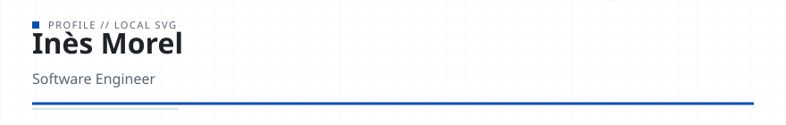

<!-- readmy:template=minimal;version=2.0.0;components=banner@2.0.0,identity@2.0.0,prose@2.0.0,projects@2.0.0,links@2.0.0,colophon@2.0.0 -->

<picture>
  <source media="(prefers-color-scheme: dark)" srcset="./assets/banner-dark.svg" />
  <source media="(prefers-color-scheme: light)" srcset="./assets/banner-light.svg" />
  
</picture>

<h1>Inès Morel</h1>

Software Engineer

<!-- section:organization omitted : missing field -->
<!-- section:location omitted : missing field -->

<h2>Overview</h2>

I build small, explicit, and observable services.

Predictable latency and concise API boundaries.

<h2>Projects</h2>
<ul>
<li><a href="https://github.com/example-user/bruine">Bruine</a> — Minimal HTTP service in Go with bounded timeouts. · Go</li>
<li><a href="https://github.com/example-user/carnet">Carnet</a> — Version-controlled technical notes in Markdown. · Markdown</li>
</ul>

<h2>Links</h2>

<a href="https://github.com/example-user">GitHub</a> · <a href="https://example.com/notes">Notes</a>

Profile generated by ReadMy minimal 2.0.0. Local SVG assets, zero third-party services.

