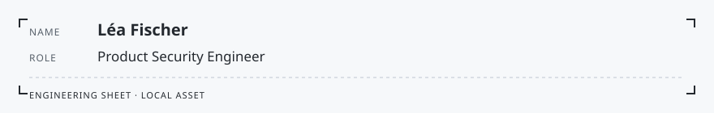

<!-- readmy:template=security;version=2.0.0;components=banner@2.0.0,identity@2.0.0,prose@2.0.0,principles@2.0.0,projects@2.0.0,links@2.0.0,colophon@2.0.0 -->

<picture>
  <source media="(prefers-color-scheme: dark)" srcset="./assets/banner-dark.svg" />
  <source media="(prefers-color-scheme: light)" srcset="./assets/banner-light.svg" />
  
</picture>

<h1>Léa Fischer</h1>

Product Security Engineer

<!-- section:organization omitted : missing field -->
<!-- section:location omitted : missing field -->

<h2>Overview</h2>

I help engineering teams minimize attack surfaces and ship timely mitigations.

Coordinated disclosure, dependency audits, and actionable audit logs.

<h2>Principles</h2>
<ul>
<li>Every vulnerability report receives an acknowledgment, then a fix timeline.</li>
<li>Secrets belong neither in source control nor in profile READMEs.</li>
<li>Every security fix must include a regression test that previously failed.</li>
</ul>

<h2>Projects</h2>
<ul>
<li><a href="https://github.com/example-user/garde-fou">Garde-fou</a> — Blocks registry publication if known credential patterns are detected. · Go</li>
<li><a href="https://github.com/example-user/dependances">Dependances</a> — Audits direct dependencies and surface licenses. · Python</li>
</ul>

<h2>Links</h2>

<a href="https://github.com/example-user">GitHub</a> · <a href="https://example.com/security">Security Advisory</a>

Profile generated by ReadMy security 2.0.0. Local SVG assets, zero third-party services.

