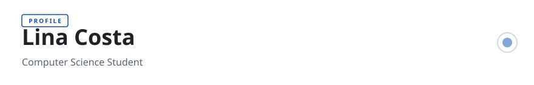
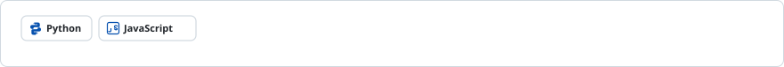

<!-- readmy:template=student;version=2.0.0;components=banner@2.0.0,identity@2.0.0,prose@2.0.0,checklist@2.0.0,projects@2.0.0,tech-badges@2.0.0,stack@2.0.0,links@2.0.0,colophon@2.0.0 -->

<picture>
  <source media="(prefers-color-scheme: dark)" srcset="./assets/banner-dark.svg" />
  <source media="(prefers-color-scheme: light)" srcset="./assets/banner-light.svg" />
  
</picture>

<h1>Lina Costa</h1>

Computer Science Student

<!-- section:organization omitted : missing field -->
<!-- section:location omitted : missing field -->

<h2>Overview</h2>

I learn computer systems by shipping small, readable programs.

This semester: networking fundamentals, test suites, and internship placement.

<h2>Roadmap</h2>
<ul>
<li><strong>done</strong> — Complete networking systems coursework</li>
<li><strong>in progress</strong> — Ship documented open-source bug fix</li>
<li><strong>planned</strong> — Present final capstone engineering project</li>
</ul>

<h2>Projects</h2>
<ul>
<li><a href="https://github.com/example-user/boussole">Boussole</a> — Lightweight HTTP status introspection client. · Python</li>
</ul>

<h2>Technologies</h2>
<picture>
  <source media="(prefers-color-scheme: dark)" srcset="./assets/tech-badges-dark.svg" />
  <source media="(prefers-color-scheme: light)" srcset="./assets/tech-badges-light.svg" />
  
</picture>

<h2>Stack</h2>
<ul>
<li><strong>Languages</strong> — Python, JavaScript</li>
</ul>

<h2>Links</h2>

<a href="https://github.com/example-user">GitHub</a> · <a href="https://example.com/lina-cv">Resume</a>

Profile generated by ReadMy student 2.0.0. Local SVG assets, zero third-party services.

