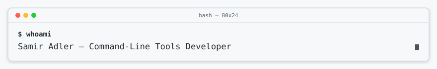
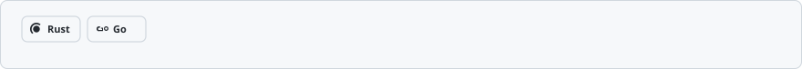

<!-- readmy:template=terminal;version=2.0.0;components=banner@2.0.0,identity@2.0.0,prose@2.0.0,projects@2.0.0,tech-badges@2.0.0,stack@2.0.0,links@2.0.0,colophon@2.0.0 -->

<picture>
  <source media="(prefers-color-scheme: dark)" srcset="./assets/banner-dark.svg" />
  <source media="(prefers-color-scheme: light)" srcset="./assets/banner-light.svg" />
  
</picture>

<h1>Samir Adler</h1>

Command-Line Tools Developer

<!-- section:organization omitted : missing field -->
<!-- section:location omitted : missing field -->

<h2>Overview</h2>

I build concise CLI tools that fail loudly and predictably.

Plain text streams, deterministic exit codes, and up-to-date manual pages.

<h2>Projects</h2>
<ul>
<li><a href="https://github.com/example-user/sentier">sentier</a> — Searches patterns across file trees and returns deterministic exit codes. · Rust</li>
<li><a href="https://github.com/example-user/marge">marge</a> — Displays configuration diffs in fixed columns. · Go</li>
</ul>

<h2>Technologies</h2>
<picture>
  <source media="(prefers-color-scheme: dark)" srcset="./assets/tech-badges-dark.svg" />
  <source media="(prefers-color-scheme: light)" srcset="./assets/tech-badges-light.svg" />
  
</picture>

<h2>Stack</h2>
<ul>
<li><strong>Languages</strong> — Rust, Go</li>
</ul>

<h2>Links</h2>

<a href="https://github.com/example-user">GitHub</a> · <a href="https://example.com/sentier">Manual</a>

Profile generated by ReadMy terminal 2.0.0. Local SVG assets, zero third-party services.

